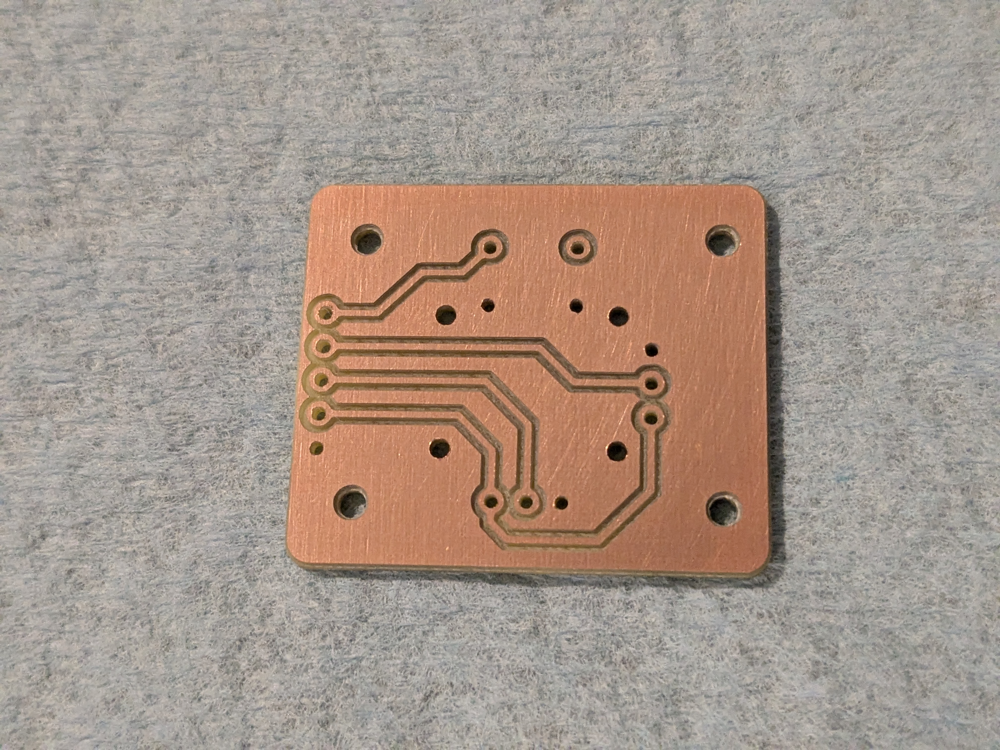
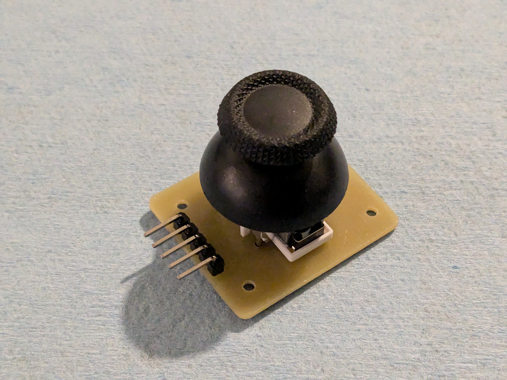

# PS5 joystick with Hall sensors

The joystick modules that are commonly used with Arduino are dirt-cheap but not very high quality.
They have a huge deadzone and very non-linear behavior.
This was acceptable for the first generation of Controlinator 3000, because the jogging code was not very accurate
and it couldn't take advantage of a high quality input device.

The Groove Control software has far superior analog jogging capabilities that expose the limitations of the cheap sticks.

There is an alternative to the old joystick modules that is almost a drop-in replacement.
It uses a Hall sensor stick that is intended for repairing PS5 gamepads.
The sensors are extremely precise with smooth movement and practically no deadzone.

All you need is a custom PCB to create a new component that matches the original pinout and mounting holes.

It was inspired by this GitHub project: https://github.com/dbenoy/thumbstick-breakout
I had to modify the board to get the standard pins.

Since the PS5 mechanism is smaller than the old one, I had to shorten the 4 mounting posts on the bottom of the face plate.

You can find the SVG for the board and the STL for the new face plate in this folder.

The one thing to note is that the direction of both X and Y are reversed.
This can be easily accounted for in software.
